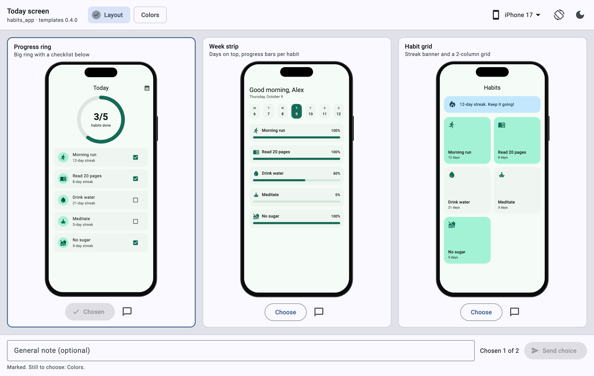
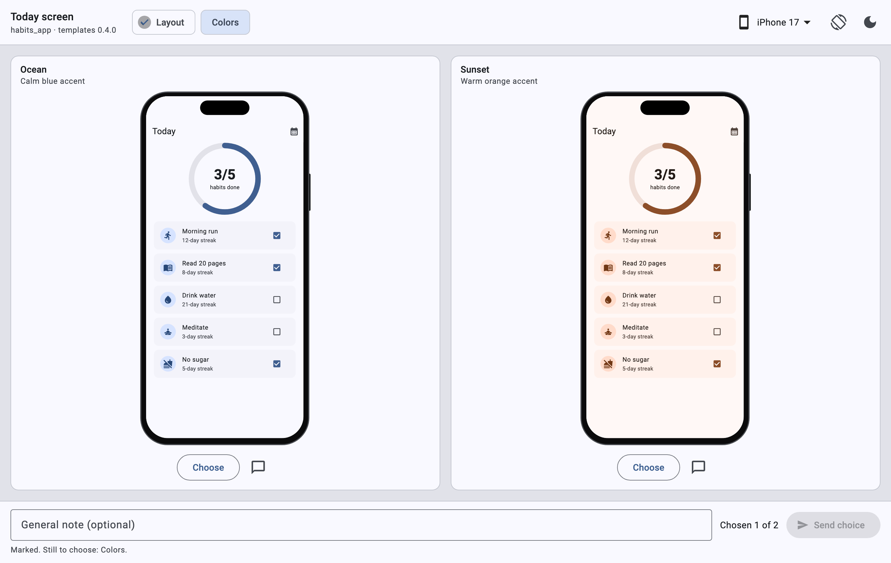
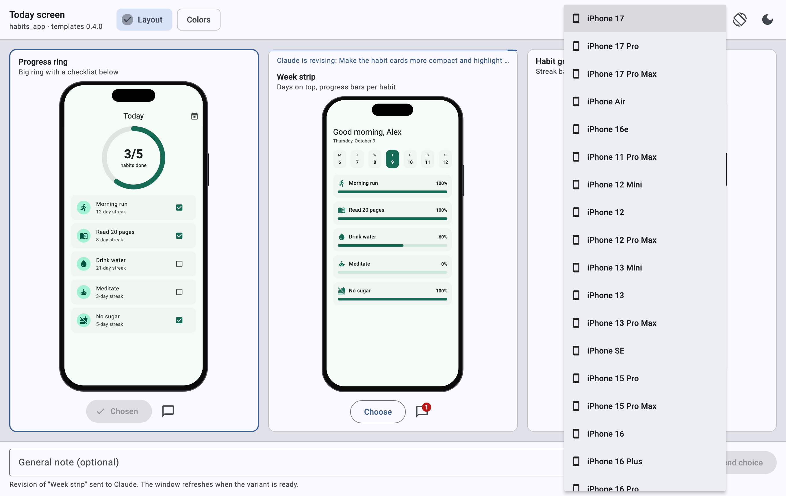
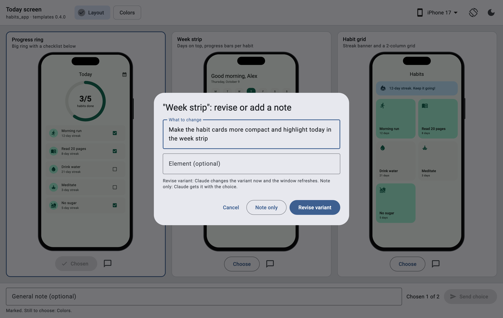
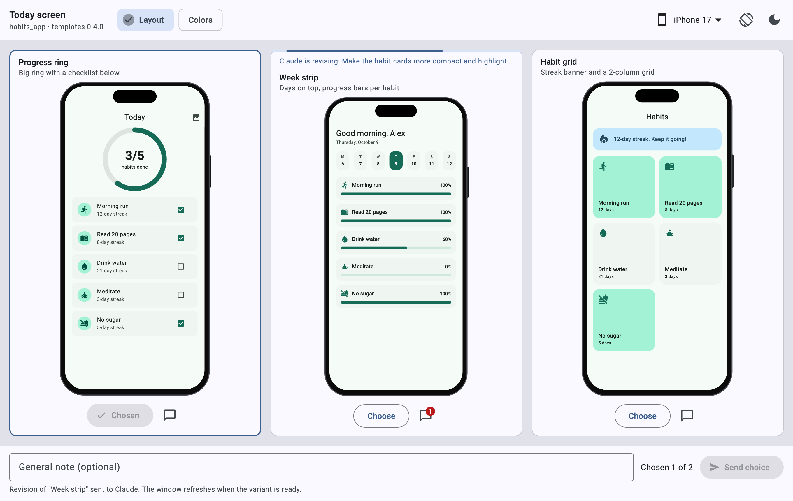

# ui-variants

A [Claude Code](https://code.claude.com) mod that shows UI variants for your Flutter project in a live macOS window instead of describing them with diagrams in the terminal.

Claude writes 2–4 variants of a screen, a color scheme or a widget into a temporary picker app. You compare them side by side in real device frames, ask for revisions and pick one. Your choice goes back to the session by itself, and Claude implements it in the project. You never have to switch to the terminal.



## What the window does

- **Side-by-side comparison.** All variants of the current question are visible at once, each in the frame of the device you pick. The menu lists iOS and Android phones and tablets, including iPhone 17, 17 Pro, 17 Pro Max, Air and 16e, plus a "no frame" mode. Landscape and dark theme are one click away.
- **Several questions at once.** When a show has independent things to choose, such as a layout and a color, you mark a variant in each question and send everything in one message.
- **Revisions on the fly.** "Revise variant" sends a request to Claude right away: "make the button blue", "increase the padding", "swap the blocks". Claude changes only that variant, and the window refreshes with a hot restart.
- **Notes for the choice.** A note on a variant, or a general note, reaches Claude together with your choice.
- **The window does not linger.** It closes after you choose and when the session ends. If the session dies, the window closes itself in about a minute.

| Several questions | Device frames |
|---|---|
|  |  |

| Ask for a revision | Claude is revising |
|---|---|
|  |  |

## Requirements

- macOS with Xcode and the Flutter SDK. If the project has `.fvm/flutter_sdk`, that Flutter is used.
- Claude Code 2.1.287 or newer: the mod is built on the mods API (a hooks module).

## Install

Enable the mod only in the Flutter projects where you want it (`local` scope). In other projects it is not loaded and takes no context.

In a Claude Code terminal session inside the project:

```
/plugin install ui-variants --marketplace DemeoStep/ui-variants
```

Answer `y` to add the marketplace, then choose "Install for you, in this repo only (local scope)".

Or from the command line in the project root:

```bash
claude plugin marketplace add DemeoStep/ui-variants
```

```bash
claude plugin install ui-variants@demeostep --scope local
```

The `local` install writes one line to the project's `.claude/settings.local.json`. Claude Code adds that file to your global git excludes, so it never ends up in a commit.

To turn the mod off and on again:

```bash
claude plugin disable ui-variants@demeostep --scope local
```

```bash
claude plugin enable ui-variants@demeostep --scope local
```

### Recommended settings

To let Claude write variants into the temporary app without permission prompts, add this to `~/.claude/settings.json`:

```json
{
  "permissions": {
    "additionalDirectories": ["/Users/<you>/Library/Caches/ui-variants"],
    "allow": ["Edit(~/Library/Caches/ui-variants/**)"]
  }
}
```

## Usage

There is nothing to run. When a task has several equally good options, Claude loads the `ui-variants` skill on its own and shows them in the window. You can also ask for variants explicitly:

```
/ui-variants:ui-variants sign-in screen
```

Skill arguments:
- `close` closes the project's window;
- `clean` closes the window and deletes the temporary app.

The first time in a project the window takes about a minute to open while the app is created and built. After that, variants refresh with a hot restart.

## How it works

1. **The skill** `skills/ui-variants/SKILL.md` tells Claude when and how to show variants. Only its description stays in context, about 90 tokens.
2. **The mod** `hooks/register.js` does nothing until the skill loads. Then it creates or updates a temporary app in `~/Library/Caches/ui-variants/<package>-<hash>/`: `flutter create`, the templates from `templates/`, a path dependency on your project, `flutter pub get`. Your project is never changed; only its `pubspec.yaml` is read.
3. **The window.** When a Claude turn changes the variants, the mod starts `flutter run -d macos` or hot restarts the running window.
4. **Feedback.** The window writes choices, notes and revisions to `.state/decision.json`. The mod sends them to the session as the next message (`$.prompt.submit`) and acknowledges them to the window through `.state/ack.json` and `.state/requests-ack.json`.

**Device frames** come from the [device_frame](https://pub.dev/packages/device_frame) package, resolved in the `>=1.2.0 <2.0.0` range. The newest iPhones, which the package does not have yet, are defined by the mod. If `device_frame` does not fit your project's dependencies, the mod builds the picker with simplified built-in frames instead.

**Network** is used only by `flutter pub get`.

## Limitations

- macOS only. On Linux and Windows the skill tells Claude to describe the variants in text instead. See [Porting to Linux or Windows](#porting-to-linux-or-windows).
- Project plugins without macOS support do not work in the window.
- The window does not open in `claude -p`: the process exits before the mod can start it.

## Porting to Linux or Windows

The mod runs only on macOS, and the macOS check is `isMacos` in `hooks/register.js`. If you need the mod on another OS, fork the repository: the code is MIT-licensed. The picker itself (`templates/lib/`) is plain Flutter and does not depend on the OS. What ties the mod to macOS is how it creates, starts, refreshes and closes the window:

| What | Where | macOS now | Linux | Windows |
|---|---|---|---|---|
| OS check | `isMacos` | `uname -s` is `Darwin` | accept `Linux` | `OS` is `Windows_NT` |
| Temporary app folder | `hostPaths` | `~/Library/Caches/ui-variants` | `$XDG_CACHE_HOME/ui-variants` or `~/.cache/ui-variants` | `%LOCALAPPDATA%\ui-variants`; `HOME` is usually not set |
| App creation | `prepareHost`, `disableSandbox` | `flutter create --platforms=macos`, sandbox off in the entitlements | `--platforms=linux` | `--platforms=windows` |
| Window title, raising the window | `templates/macos/Runner/MainFlutterWindow.swift.tmpl`, `lib/_host/window.dart` | Swift and the `ui_variants/window` channel | `linux/runner/my_application.cc` | `windows/runner/main.cpp` |
| Built app, found by its path to close it | `appBundle` | `build/macos/Build/Products/Debug/ui_variants_host.app` | `build/linux/<arch>/debug/bundle/ui_variants_host` | `build\windows\x64\runner\Debug\ui_variants_host.exe` |
| Detached launch | `LAUNCH_SCRIPT` | `sh`, `nohup`, `perl` with `setsid`, `flutter run -d macos` | `-d linux`; `setsid` from util-linux if `perl` is missing | no `sh` or `perl` |
| Hot restart | `hotRestart` | `kill -USR2` to `flutter run` | the same | no signals |
| Closing the window | `STOP_SCRIPT`, `isAlive`, `windowPid` | `ps`, `kill`, `pkill` | the same | `tasklist`, `taskkill` |
| Reading the `flutter run` log | `logTail` | `tail -c` | the same | read it with `$.fs` |
| Deleting files | `prepareHost`, `clean` in `answerSkill` | `rm -rf` | the same | no `rm` |
| Finding Flutter | `findFlutter`, `searchFlutter` | `which`, the login shell, Homebrew paths | add the snap path | `where flutter`, `flutter.bat` |
| Toolchain | | Xcode | clang, cmake, ninja-build, pkg-config, libgtk-3-dev | Visual Studio with "Desktop development with C++" |

**Linux** is the short way: the Unix commands and SIGUSR2 behave as on macOS. The mod sends the signal by name, so its different number on Linux does not matter.

**Windows** is harder because of hot restart. `flutter run` takes no signals there, and `$.process.spawn` writes to a process's stdin only once, so the mod cannot drive `flutter run --machine` and its `app.restart` command by itself. One way out is a small launcher in Dart, which ships with Flutter: it starts `flutter run --machine`, watches request files in `.state/` and sends `app.restart` or `app.stop`. Also check that `flutter.bat` starts through `$.process.run`, which runs commands without a shell, and that the window outlives the Claude Code process.

`tests/register.test.ts` stubs every command the mod runs, so update the stubs together with the code.

## Development

```bash
claude plugin validate .
```

```bash
claude plugin test .
```

Bump `version` in `.claude-plugin/plugin.json` after every change. The mod uses it to update the templates in already created temporary apps; `lib/registry.dart`, `lib/theme.dart` and `lib/variants/` are never overwritten.

The screenshots show the real picker window rendered with demo variants.

## License

[MIT](LICENSE) © 2026 Oleksii Horiainov
